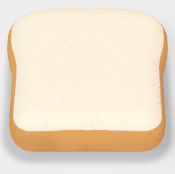
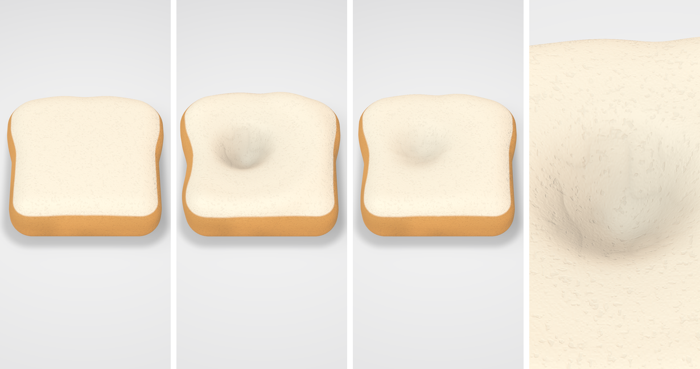

# SQUISH LAB — 食パンスクイーズ MVP

> スマホの中に、本物のスクイーズ屋さん。

スクイーズの **触感そのもの** を作って楽しむ物理シミュレーターの第一段階。
今回は **食パンスクイーズ1個を触って、5秒以内に「気持ちいい」と思える** ことだけに集中している。
ショップ・ガチャ・コレクションなどは未着手。





*左から: 静止 / 1秒押した状態 / 離して1秒後 / 寄り。WebGL プレビュー（後述）で、
Unity と同じシェーダーコードとソルバーの出力を描画したもの。*

---

## 動かし方

**必要なもの:** Unity 6（6000.0 LTS 以降）、iOS Build Support、Xcode

1. Unity Hub →「Add project from disk」で `SquishLab/` フォルダを開く
   （`ProjectVersion.txt` と違うバージョンでも問題ない。Hub でインストール済みの Unity 6 を選ぶ）
2. 初回に自動でセットアップされる（`SquishLabSetup.cs`）
   - `Assets/SquishLab/Scenes/SquishLab.unity` を作成し Build Settings に登録
   - 素材プリセット（`Resources/SquishMaterials/*.asset`）を作成
   - リニア色空間・縦画面・iOS 15 以上・Bundle ID などを設定
   - うまく行かなかった時はメニュー **SQUISH LAB → Rebuild Prototype Scene**
3. **Play** を押す。空のシーンでも `SquishLabBootstrap` が一式を組み立てるので、どのシーンからでも触れる

**エディタ操作:** 左クリック = 1本指で押す / **Alt(Option)+左クリック** = 中心対称の2本指（つまみ確認用）

**iPhone 実機:** File → Build Profiles → iOS → Build → 出力された Xcode プロジェクトを実機へ。
`CoreHaptics.framework` は `SquishIOSPostProcess.cs` がビルド時に自動でリンクする。

### 調整パネル

右下の **Tune** で開閉（エディタと Development Build のみ表示）。画面の下半分に出るので、上半分の食パンを触りながら数値を変えられる。

- 物性 11 項目・見た目・音・触覚のスライダー
- fps / ソルバー時間 / 頂点転送時間 / **離してから 95% 戻るまでの実測秒**
- 触覚の強さ・鋭さ、空気音・プチプチ音の量のリアルタイム表示
- プリセット切替（Slow Rise Bread / Fast Foam / Mochi）、Reset shape、60↔120fps
- **Copy JSON**: 実機で調整した値をクリップボードへ → エディタでアセットに反映

エディタでは `SquishMaterial` アセットを直接書き換えるので、プレイを止めても値が残る。

---

## 方式の選択（なぜこの作りか）

| 方式 | 局所変形 | スローライズ | iPhone 60fps | 調整しやすさ | 判断 |
|---|---|---|---|---|---|
| オブジェクト全体の scale / 固定アニメ | ✗ | ✗ | ◎ | ◎ | 禁止要件 |
| 有限要素法（FEM） | ◎ | ○ | ✗ 重い | ✗ | 過剰 |
| 体積メッシュ + PBD / Verlet | ◎ | △ 粘性の表現に工夫が要る | △ 内部頂点・拘束反復が重い | △ 反復回数で特性が変わる | 不採用 |
| 頂点シェーダーで変位（GPU のみ） | ○ | △ 状態を持てない | ◎ | ○ | 不採用 |
| **表面頂点の2層粘弾性モデル（CPU）** | ◎ | **◎ 時定数を直接指定** | ◎ 8k 頂点で約 1.5ms | **◎ 各パラメータが1つの物理量に対応** | **採用** |

**採用した「2層粘弾性モデル」** （`Scripts/Core/SquishSolver.cs`）:

```
指のタッチ ─ Raycast(静止形状) ─> 接触点・法線（ローカル座標）
                │
                ▼  中心ほど強いカーネル (1-x²)² ＋ 周囲ごと沈む浅い皿 ＋ 外周のわずかな盛り上がり
        目標変位 T（頂点ごと）
                │
   ┌────────────┴─────────────┐
   │ 記憶層 mem（へこみの記憶）  │  T が「今より先」 → 速く沈む（指が動かす）
   │                          │  T が手前/ゼロ    → exp(-t/τ) でゆっくり戻る（スローライズ）
   │  + 隣接頂点への拡散         │  離した直後は粘着で戻り始めが遅れる（StickyAmount）
   └────────────┬─────────────┘
                ▼  ばね・ダンパ（半陰的オイラー, 120Hz サブステップ）
        表面層 disp（実際に描く変位）  ← 押した瞬間の「むにゅ」の遅れ、少しの揺れ
                │
                ▼  ＋ 本体全体の小さな揺れ ＋ へこんだ体積ぶん側面がふくらむ
           頂点 → GPU（法線は毎フレーム再計算、圧縮量は頂点カラーでシェーダーへ）
```

- **なぜ2層か:** 本物のスローライズフォームは「押すと素直に沈み、離すと粘性でゆっくり戻る」。
  1つのばねでは「ゆっくり戻る＝押してもゆっくり沈む」になってしまう。
  沈み（指が動かす）と戻り（素材の粘性）を別のレートにし、その上に弾性層を重ねることで、
  反発しない slow-rise と、触れた瞬間の手応えを両立した。
- **法線方向と接線方向を別々に判定** する。まとめて判定すると、なぞった時の横の引っ張りで
  へこみの記憶が消えたり、つまみで持ち上げる動きが「戻り」と誤判定される（テストで検出して修正済み）。
- **Raycast は静止形状に対して行う。** 変形中の形に当てると、へこみの奥に当たって
  さらにへこむ…という正のフィードバックで暴れるため。
- **メッシュは溶接済みの格子**（角丸ボックスを食パンの形に歪めたもの, 約 8,200 頂点）。
  天面の頂点密度が均一なので、どこを押しても同じ品質でへこみ、継ぎ目で法線や拡散が途切れない。
- **指が無く、すべて戻りきったらスリープ** して計算と GPU 転送を止める。

---

## 物性パラメータ

`SquishParams`（0..1 の正規化値）を `SquishMaterial`（ScriptableObject）が持つ。
物理量への変換は `SquishParams` のプロパティに集約しているので、素材を増やす時はアセットを作るだけ。

| パラメータ | 意味 | 物理量 |
|---|---|---|
| **Softness** | 柔らかさ | 沈む速さ・初期深さ・へこみの広さ |
| **RecoverySpeed** | 戻る速さ | 95% 復元時間 12秒〜0.3秒（対数）。初期値 ≈ 4.3秒 |
| **Elasticity** | 弾力 | 表面層のばね定数・全体の揺れの硬さ |
| **Damping** | 減衰 | 減衰比 ζ 0.18〜1.4 |
| **MaxDeformation** | 最大へこみ | 厚みに対する割合 |
| **StickyAmount** | 粘着感 | 離してから戻り始めるまでの遅れ 0.02〜0.7秒 |
| **Stretchiness** | 伸び | ドラッグ・つまみで横に引っ張られる量、つまみの持ち上がり |
| FingerRadius / Bulge / Coupling / Wobble | 形の応答 | 指の半径 / 縁の盛り上がり / へこみの馴染み / 全体の揺れ |

プリセット: **SlowRiseBread**（既定）, **FastFoam**, **Mochi**。
今後の Jelly / Gel / Silicone / Water Filled なども同じ構造で追加できる。

---

## 見た目

`Resources/Shaders/SquishFoam.shader`（URP と Built-in の両方に対応。中身は `SquishFoamCommon.hlsl` で共通）

- パイプラインのライトに頼らない**商品写真風のスタジオ照明**（キー＋フィル＋半球環境光）
- 回り込む拡散（wrap）と明暗境界の暖色で、光が少し中に入る**フォームらしさ**
- テクスチャ不要の**スポンジの気孔**（静止位置ベースのノイズ → 変形しても模様が泳がない）
- **圧縮量に応じて** 気孔が潰れて目が詰まる・少し濃くなる・へこみの奥が暗くなる・細かいシワ
- 耳（クラスト）は側面だけ、角はすべて丸い
- 床は白〜薄いグレーのグラデーションと、距離場で描く柔らかい接地影

## 音（ASMR）

`Core/SquishSynth.cs`（エンジン非依存）を `SquishAudio` がオーディオスレッドで鳴らす。
**録音素材を毎回同じように鳴らすのではなく、ソルバーの「へこみ体積の変化率」から毎サンプル合成**するので、
見た目と音が常に同期し、同じ音が2回鳴らない。

| 層 | 音 | 何に連動するか |
|---|---|---|
| Squish | 低い「むにゅ」（下降する低音 + 掃引する帯域ノイズ） | 触れた瞬間・限界に達した瞬間。音量/ピッチ/長さを毎回ランダム化 |
| Air | 空気が抜ける「ぷしゅ」 | 押し込む速さ（速いほど大きく高く）。復元中はごく小さく |
| Crackle | フォームの気泡がつぶれるプチプチ | 押し込む速さに比例した粒の密度。復元中はまばら |

録音した素材を使いたい場合は `SquishAudio.PressClips` に入れると、ピッチ・音量をランダム化して再生する。

## ハプティクス

`Plugins/iOS/SquishHaptics.mm`（Core Haptics）。強い単発ではなく、
**連続イベントを1本流し続けて強さ・鋭さを毎フレーム変える**。

| 段階 | 触覚 |
|---|---|
| 押し始め | ごく弱く低い単発（ふにっ）＋連続振動を開始 |
| 押し込み中 | 沈む速さに比例して強く、深いほど少し鋭く。30Hz 前後のゆらぎで粒感 |
| 指を止めて押している | ほぼ消える（ずっと震えるのは不自然） |
| 限界付近 | 一度だけ「底付き」の単発、押し込み続ける間は細かいティック |
| 離す | 連続振動を止め、粘着感に応じたごく弱い単発 |

Core Haptics 非対応端末は `UIImpactFeedbackGenerator(.soft)` にフォールバック。

---

## テスト（Unity 不要）

コア（ソルバー・メッシュ・音・触覚マッピング）はエンジン非依存なので dotnet でテストできる。

```sh
cd SquishLab/Tests
dotnet run -c Release
```

| テスト | 確認していること |
|---|---|
| mesh | 閉じた多様体・外向き法線・頂点数・耳と山とふっくら感 |
| press | 局所的・距離で単調減少・周囲が追従・底面は動かない・押した場所で形が変わる・**0.1秒で半分以上沈む**・押し続けると深くなる・**三角形が裏返らない** |
| release | **離して0.3秒でまだ 90% 残る** / **95% 復元が 3〜6 秒で設定値の ±30% 以内** / どのプリセットでも反発（オーバーシュート）しない |
| params | RecoverySpeed・MaxDeformation が単調に効く |
| drag / pinch | なぞった跡がゆっくり戻る / 2本指の間が持ち上がる |
| stability | ランダムなパラメータ・不規則な dt・多指操作で NaN・発散なし |
| sleep / perf | 戻りきったら計算停止 / 1フレームの計算時間 |
| synth / haptics | 無音時は無音・クリップしない / 空気音が速さに追従 / むにゅが毎回違う / 触覚の段階 |

### 見た目のプレビュー（Unity 不要）

`Tools/preview/` は **Assets の実シェーダーを機械的に GLSL へ変換**して、テストが書き出した
変形メッシュを WebGL（ヘッドレス Chromium）で描く。カメラと照明は `StudioStage` と同じ計算。
README の画像はこれで作っている。使い方は `Tools/preview/build.py` の先頭を参照。

---

## 構成

```
SquishLab/
├── Assets/SquishLab/
│   ├── Scripts/Core/        エンジン非依存（テスト対象）
│   │   ├── SquishSolver.cs      2層粘弾性ソルバー
│   │   ├── SquishParams.cs      物性パラメータと物理量への変換・プリセット
│   │   ├── BreadMeshBuilder.cs  食パン形状の生成
│   │   ├── SquishSynth.cs       プロシージャル ASMR 音源
│   │   └── FeedbackMapper.cs    ソルバー → 音・触覚の対応
│   ├── Scripts/Runtime/     MonoBehaviour
│   │   ├── SquishyBody.cs       メッシュ・ソルバー・GPU 転送
│   │   ├── SquishInput.cs       タッチ/マウス → 接触点
│   │   ├── SquishFeedback.cs    音と触覚を鳴らす
│   │   ├── SquishAudio.cs / SquishHaptics.cs
│   │   ├── StudioStage.cs       カメラ・床・影
│   │   ├── SquishDebugPanel.cs  調整パネル
│   │   ├── SquishMaterial.cs    素材アセット
│   │   └── SquishLabBootstrap.cs
│   ├── Scripts/Editor/      初回セットアップ・メニュー・iOS ビルド後処理
│   ├── Resources/Shaders/   フォーム・床シェーダー
│   └── Plugins/iOS/         Core Haptics ブリッジ
├── Tests/                   dotnet テスト（UnityStub で Vector3/Mathf を代替）
├── Tools/preview/           WebGL プレビュー
└── docs/
```

---

## 検証状況と制約（正直に）

この MVP は **Unity エディタも iPhone 実機もない環境で作った**。そのため次のように検証している。

| 対象 | 検証方法 | 状態 |
|---|---|---|
| 物理・メッシュ・音・触覚マッピング | dotnet テスト 19 本 | ✅ 全て通過 |
| Runtime C# | Unity 2021.3 の参照アセンブリでコンパイル（`UNITY_IOS` 有り/無し） | ✅ エラー・警告なし |
| シェーダー | glslang（HLSL フロントエンド）で構文チェック + GLSL 変換して WebGL で描画 | ✅ |
| Editor C#（`SquishLabSetup` / `SquishIOSPostProcess`） | 参照アセンブリが入手できずコンパイル未確認 | ⚠️ 未検証 |
| `SquishHaptics.mm` | iOS SDK が無くコンパイル未確認 | ⚠️ 未検証 |
| 実機の 60fps・触覚の気持ちよさ・音の質感 | — | ⚠️ **実機で触って調整が必要** |

**MVP 完成条件 10「もう一回押したい品質」は実機で触らないと判断できない。**
パラメータの初期値はテストとプレビューで詰めたが、最終調整は実機で調整パネルを使って行う前提。
特に音は合成音なので、物足りなければ `PressClips` に録音素材を入れて比較してほしい。

### 既知の制約・今後

- 対応パイプライン: Built-in（既定）と URP。HDRP は未対応
- 影はシャドウマップではなく静止形状からの解析的な影（押しても影の形は変わらない）
- 新 Input System のみの設定でも動くようにしてあるが、そちらの経路は未コンパイル
- 頂点数を増やす（さらに滑らかにする）なら、ソルバーを Burst / Jobs 化するのが次の一手
- MVP の後: 素材追加 → Squish Test（復元時間の計測はパネルに実装済み）→ 撮影モード → 制作フロー
